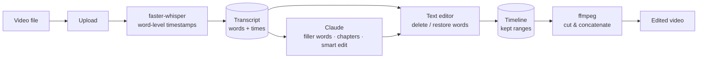
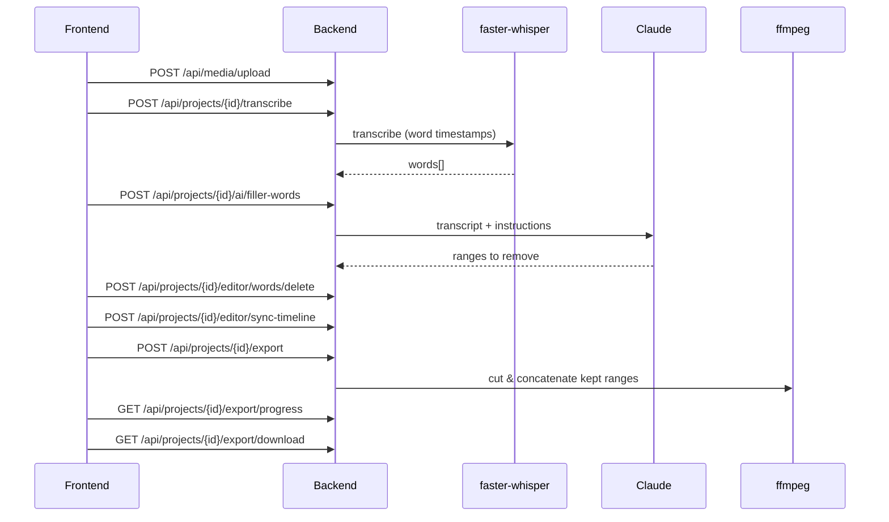
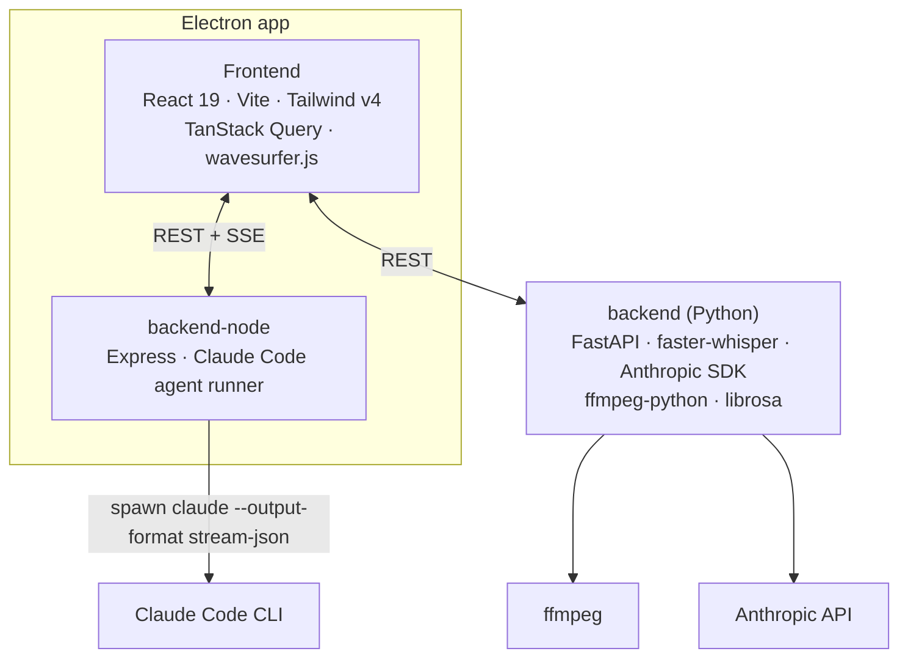

# FrameTamer — edit video by editing text

A desktop video editor in the spirit of Descript. A video is transcribed with word-level timestamps, and editing the transcript edits the video: delete a word and the corresponding fragment disappears from the cut. AI handles the tedious parts — finding filler words, generating chapters and applying edits described in plain language.

The UI ships under the working name **ClipForge**.

## Contents

- [Features](#features)
- [How it works](#how-it-works)
- [Architecture](#architecture)
- [API](#api)
- [Getting started](#getting-started)
- [Configuration](#configuration)

## Features

| Feature | Description |
|---|---|
| **Projects** | Upload a video, get a project with thumbnail, metadata and search. |
| **Transcription** | Local speech-to-text with faster-whisper and word-level timestamps — audio never leaves the machine. |
| **Text-based editing** | Delete or restore words in the transcript; the timeline is re-synced to the remaining words. |
| **Waveform** | wavesurfer.js waveform for precise navigation and range selection. |
| **Filler words** | Detects filler words in Russian and English speech so they can be cut in one pass. |
| **Chapters** | Generates chapters from the transcript. |
| **Smart edit** | Describe an edit in natural language ("remove the intro", "keep only the answers") and let Claude apply it. |
| **AI agent tasks** | Long-running Claude Code agent tasks per project with live log streaming and a kill switch. |
| **Export** | Cuts and concatenates the kept fragments with ffmpeg, with progress reporting and download. |
| **Desktop app** | Electron shell with native open/save dialogs, packaged with electron-builder. |

## How it works





## Architecture



```
frontend/       — React 19, Vite, TypeScript, Tailwind CSS v4, TanStack Query, React Router, wavesurfer.js
backend/        — FastAPI: projects, media, transcription, editor, AI and export routers
backend-node/   — Node/TypeScript server: projects, media and Claude Code agent tasks with SSE log streaming
electron-app/   — Electron shell; bundles the frontend and backend-node into a desktop app
```

## API

Python backend (`backend/`):

| Method | Path | Purpose |
|---|---|---|
| `POST` / `GET` | `/api/projects` | create / list projects |
| `GET` / `PATCH` / `DELETE` | `/api/projects/{id}` | read / update / delete a project |
| `GET` | `/api/projects/{id}/thumbnail`, `/video` | preview and source video |
| `POST` | `/api/media/upload` | upload media |
| `POST` | `/api/projects/{id}/transcribe` | run transcription |
| `GET` / `PUT` | `/api/projects/{id}/transcript` | read / save the transcript |
| `GET` | `/api/projects/{id}/waveform` | waveform peaks |
| `POST` | `/api/projects/{id}/editor/words/delete`, `/restore` | text-based cuts |
| `POST` | `/api/projects/{id}/editor/sync-timeline` | rebuild the timeline from the transcript |
| `POST` | `/api/projects/{id}/ai/filler-words` | detect filler words |
| `POST` | `/api/projects/{id}/ai/chapters` | generate chapters |
| `POST` | `/api/projects/{id}/ai/smart-edit` | natural-language edit |
| `POST` | `/api/projects/{id}/export` | start export |
| `GET` | `/api/projects/{id}/export/progress`, `/download` | export progress and result |

Agent tasks (`backend-node/`): `GET /tasks`, `GET /projects/:id/tasks`, `GET /tasks/:taskId`, `GET /tasks/:taskId/stream` (SSE), `POST /tasks/:taskId/kill`, `POST /projects/:id/transcribe`.

## Getting started

Requirements: Python 3, Node.js, ffmpeg in `PATH`, an Anthropic API key (and the Claude Code CLI for agent tasks).

```bash
# Python backend
cd backend
python -m venv .venv && source .venv/bin/activate
pip install -r requirements.txt
cp .env.example .env
python run.py --reload            # http://localhost:8000

# frontend
cd ../frontend
npm install
npm run dev

# desktop app (dev mode) and distributable build
cd ../electron-app
npm install
npm run dev
npm run build
```

## Configuration

| Variable | Description |
|---|---|
| `ANTHROPIC_API_KEY` | required for AI features |
| `ANTHROPIC_MODEL` | Claude model to use |
| `WHISPER_MODEL` | `tiny` … `large-v3` |
| `WHISPER_DEVICE` | `auto` / `cpu` / `cuda` |
| `WHISPER_COMPUTE_TYPE` | `auto` / `float32` / `float16` / `int8` |
| `PROJECTS_DIR`, `MEDIA_DIR`, `TEMP_DIR` | storage locations (default `~/ClipForge/…`) |
| `HOST`, `PORT`, `DEBUG` | server settings |
